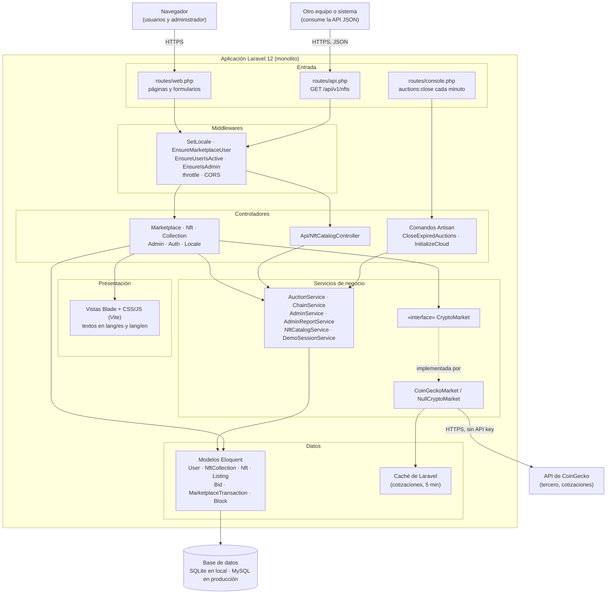
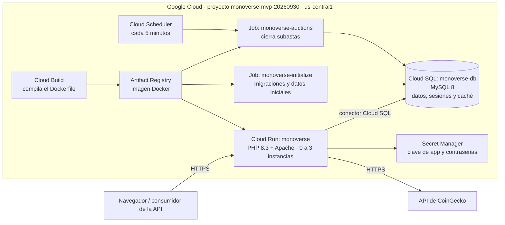

# Diagrama de arquitectura

Refleja el código. Los diagramas usan Mermaid.

Monoverse es un monolito Laravel 12 organizado por capas: rutas y middlewares, controladores, servicios de negocio y modelos Eloquent. El detalle de clases está en [DIAGRAMA_CLASES.md](DIAGRAMA_CLASES.md).

## 1. Arquitectura lógica (capas)

Puntos clave:

- **Dos formas de entrar:** las páginas web (sesión, formularios, vistas Blade) y la API pública de solo lectura `GET /api/v1/nfts`, sin sesión ni autenticación.
- **Middlewares:** `EnsureMarketplaceUser` exige sesión, `EnsureUserIsActive` bloquea a las cuentas suspendidas, `EnsureIsAdmin` protege el panel y `SetLocale` aplica el idioma elegido (español o inglés).
- **Lógica de negocio en servicios:** subastas, cadena de bloques, moderación, reportes y catálogo. Algunas operaciones (acuñar, comprar, vender) siguen en `MarketplaceController`, que también consulta modelos directamente.
- **Integración con un tercero:** el mercado muestra cotizaciones reales de CoinGecko. El controlador solo conoce la interfaz `CryptoMarket`; si CoinGecko falla, la sección se oculta y el resto de la página carga normal.
- **Cadena de auditoría:** `ChainService` agrega un bloque con hash SHA-256 por cada evento relevante (acuñación, venta, moderación) y `/cadena` la verifica públicamente.

## 2. Despliegue en Google Cloud

