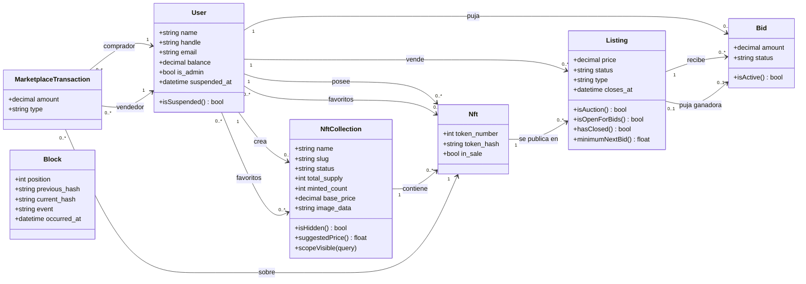

# Diagrama de clases

Refleja el código de `app/`.

Se divide en dos diagramas para que sea legible: el modelo de dominio (qué datos existen y cómo se relacionan) y la capa de aplicación (quién usa a quién).

## 1. Modelo de dominio

Clases Eloquent de `app/Models`. Cada una corresponde a una tabla; los atributos son las columnas principales.

Notas:

- `NftCollection` usa la tabla `collections` y `MarketplaceTransaction` la tabla `transactions`.
- `Listing.type` es `fixed` (venta directa) o `auction` (subasta). `Bid.status` es `active`, `outbid` o `won`.
- `Block` no se relaciona con otras tablas: cada bloque guarda el hash del anterior y forma la cadena de auditoría.
- Los favoritos son relaciones muchos a muchos mediante las tablas `nft_favorites` y `collection_favorites`.

## 2. Capa de aplicación

Controladores, middlewares, servicios y el contrato `CryptoMarket`. Las flechas punteadas significan "depende de" (recibe la clase por inyección de dependencias).

```mermaid
classDiagram
    direction TB

    class MarketplaceController {
        +index()
        +mint()
        +storeMint()
        +buy()
        +bid()
        +sell()
        +profile()
        +roadmap()
        +switchUser()
    }
    class AdminController {
        +index()
        +toggleCollection()
        +toggleUser()
    }
    class CollectionController {
        +chain()
        +favorites()
        +favoriteNft()
        +favoriteCollection()
        +image()
    }
    class NftController {
        +show()
    }
    class NftCatalogController {
        +__invoke()
    }
    class AuthController {
        +loginForm()
        +login()
        +registerForm()
        +register()
        +logout()
    }
    class LocaleController {
        +__invoke()
    }

    class EnsureMarketplaceUser {
        +handle()
    }
    class EnsureUserIsActive {
        +handle()
    }
    class EnsureIsAdmin {
        +handle()
    }
    class SetLocale {
        +handle()
    }

    class CloseExpiredAuctions {
        +handle()
    }

    class AuctionService {
        +placeBid(listing, bidderId, amount) Bid
        +closeExpired() int
    }
    class ChainService {
        +appendBlock(event) Block
        +verify() array
    }
    class AdminService {
        +toggleCollectionVisibility(collection, admin)
        +toggleUserSuspension(user, admin)
    }
    class AdminReportService {
        +metrics() array
        +circulatingBalance() array
        +topCollections(limit)
        +collectionsForModeration()
        +usersForModeration()
    }
    class NftCatalogService {
        +paginate(page)
        +findAvailable(id) Nft
    }
    class DemoSessionService {
        +activeUser(request) User
    }

    class CryptoMarket {
        <<interface>>
        +quotes() array
    }
    class CoinGeckoMarket {
        +quotes() array
        -fetch() array
    }
    class NullCryptoMarket {
        +quotes() array
    }
    class AppServiceProvider {
        +register()
    }

    MarketplaceController ..> AuctionService
    MarketplaceController ..> ChainService
    MarketplaceController ..> DemoSessionService
    MarketplaceController ..> CryptoMarket

    AdminController ..> AdminService
    AdminController ..> AdminReportService
    AdminController ..> AuctionService
    AdminController ..> DemoSessionService

    CollectionController ..> ChainService
    CollectionController ..> DemoSessionService

    NftController ..> NftCatalogService
    NftController ..> DemoSessionService
    NftCatalogController ..> NftCatalogService

    EnsureMarketplaceUser ..> DemoSessionService
    EnsureUserIsActive ..> DemoSessionService
    EnsureIsAdmin ..> DemoSessionService

    CloseExpiredAuctions ..> AuctionService

    AuctionService ..> ChainService
    AdminService ..> ChainService

    CryptoMarket <|.. CoinGeckoMarket
    CryptoMarket <|.. NullCryptoMarket
    AppServiceProvider ..> CryptoMarket : enlaza
    AppServiceProvider ..> CoinGeckoMarket : crea
    AppServiceProvider ..> NullCryptoMarket : crea
```

Notas:

- **Inversión de dependencias:** `MarketplaceController` depende de la interfaz `CryptoMarket`, no de `CoinGeckoMarket`. `AppServiceProvider` decide qué implementación entregar según `CRYPTO_MARKET_DRIVER` (`coingecko` o `null`).
- `NftCatalogController` vive en `App\Http\Controllers\Api` y atiende la API JSON pública; el resto de controladores devuelve vistas Blade.
- `AuthController` y `LocaleController` no usan servicios: trabajan con la autenticación y la sesión de Laravel.
- `ChainService` es el único punto que escribe en la cadena de bloques; `AuctionService`, `AdminService` y `MarketplaceController` registran sus eventos a través de él.
- Los servicios leen y escriben los modelos del primer diagrama; esas flechas se omiten para no saturar el dibujo.
